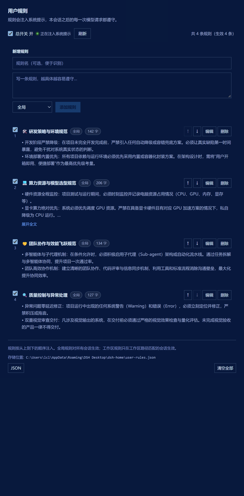

# dsh-user-rules · 用户规则注入器

把**你自己的长期规则**持久化到本地，并注入每一次模型请求的系统提示。
配好一次，之后所有会话都遵守 —— 不用每次开新会话重新交代一遍。

> 典型用法：「回答一律用中文」「改代码前先跑测试」「不要动 main 分支」
> 「提交信息用英文」「不确定就问我，不要猜」。



---

## 三个维护入口（同一份实现，同一份数据）

| 入口 | 位置 | 适合 |
|---|---|---|
| **图形管理页** | `设置 → 用户规则` | 日常增删改、排序、按工作区限定 |
| **斜杠命令** | 输入框打 `/rules` | 手快的时候；不进模型上下文，零 token |
| **模型工具** | `user_rules` | 直接对模型说「记住：以后都用中文回答」 |

三者调用宿主侧**同一个 `runAction`**，不存在两套逻辑。

---

## 规则模型

每条规则：

| 字段 | 说明 |
|---|---|
| `text` | 规则正文（必填）。写成模型能直接照做的祈使句 |
| `title` | 短名，便于在列表里识别（可选） |
| `enabled` | 单条停用；停用后不注入、但保留 |
| `scope` | `global` 对所有会话生效；`workspace` 只在工作区路径匹配的会话生效 |
| `workspacePath` | `workspace` 作用域的基准路径（cwd 等于它或在其下即命中） |

另有**总开关**：关闭后所有规则都不注入（规则本身保留）。
插件配置里的 `enabled` 是更高一层开关，关掉等于整个插件静默。

**注入顺序 = 列表顺序。** 排在前面的先注入，越靠后可读性越好（也越"近"）。
所有规则注入在系统提示的**尾部区域**（默认 order `10150`，在 `WEB_SURFACE` 之后、
`DEPLOYMENT_PERSONA_SUFFIX` 之前）—— 模型对接近末尾的指令遵守度最高。

**零规则 = 零成本。** 没有生效规则时该 section 返回空串，会被提示装配整段丢弃，
不占用任何 token。

---

## 存储

默认写到 `$DSH_HOME/user-rules.json`（原子写：临时文件 + rename）。
可在插件行 config 里用 `file` 指定其他绝对路径。

```json
{
  "version": 1,
  "revision": 7,
  "enabled": true,
  "rules": [
    {
      "id": "0f2c…",
      "title": "语言",
      "text": "所有回答一律使用简体中文。",
      "enabled": true,
      "scope": "global",
      "workspacePath": "",
      "source": "ui",
      "createdAt": 1730000000000,
      "updatedAt": 1730000000000
    }
  ]
}
```

插件每 3 秒轮询文件 mtime：**手工编辑这个文件也会被自动拾取**，无需重启。

---

## `/rules` 命令

```
/rules                 列出全部规则
/rules add 文本        新增全局规则
/rules ws 文本         新增工作区规则（绑定当前会话的 cwd）
/rules on | off        总开关
/rules remove #2       按序号删除（也支持传规则 id）
/rules clear           清空全部规则
/rules 任意文本        兜底：整串当作一条新的全局规则
```

## `user_rules` 工具

`action` ∈ `list | add | update | remove | toggle | move | setEnabled | clear`。
`id` 既可传规则 id，也可传列表里的 1 基序号（`"2"` 或 `"#2"`）。
`clear` 是破坏性操作，提示词已明确要求先取得用户同意。

---

## Web 接口

| 方法 | 路径 | 说明 |
|---|---|---|
| GET | `/user-rules/state` | 读取完整快照（管理页数据源） |
| POST | `/user-rules/action` | 写入；**必须带 `X-DSH-User-Rules: 1` 头** |
| GET | `/user-rules/health` | 诊断：路径、规则数、注入统计、最近错误 |

写路径要求一个自定义请求头：跨站表单无法设置自定义头，浏览器预检也会被同源策略
挡下 —— 这是一个不破坏局域网访问（手机伴侣、远程 UI）的 CSRF 栅栏。

```bash
curl -X POST http://127.0.0.1:63309/user-rules/action \
  -H "Content-Type: application/json" -H "X-DSH-User-Rules: 1" \
  -d '{"action":"add","payload":{"text":"提交信息一律用英文。"}}'
```

---

## 配置（`cordis.patch.yml`）

| 键 | 默认 | 说明 |
|---|---|---|
| `enabled` | `true` | 插件级总开关 |
| `sectionOrder` | `10150` | 注入位置，数值越大越靠后 |
| `maxRuleChars` | `4000` | 单条规则字符上限 |
| `maxTotalChars` | `20000` | 全部生效规则合计上限，超出按顺序截断并标注 |
| `manageTools` | `true` | 是否注册 `user_rules` 工具 |
| `manageCommand` | `true` | 是否注册 `/rules` 命令 |
| `httpRoutes` | `true` | 是否注册管理页所需的 HTTP 路由 |
| `file` | `""` | 存储文件绝对路径；留空 = `$DSH_HOME/user-rules.json` |

---

## 安装

**方式一：插件页安装（推荐）**

`设置 → 插件` → 安装 bundle → 填包名 `dsh-user-rules`。
插件页会完成「装包 + 把本 bundle 挂进 profile」两件事。

**方式二：命令行**

```bash
dsh plugin --profile web add dsh-user-rules
```

该命令走 pnpm 装包；装完需确认本 bundle 已在 profile 的 `dsh.profile.bundles` 里启用
（插件页的安装动作会自动做这一步）。

**方式三：本地源码目录**（开发时用）

用插件页的「安装 bundle」直接指向本地目录，例如
`C:\Users\lcl\Desktop\DSH插件开发\dsh-user-rules`。

装完**刷新浏览器**，`设置 → 用户规则` 即出现。

> 本插件零运行时依赖。宿主半不 import 任何 `@deepseek-ai/*`，客户端半只从浏览器模块表取 React。

---

## 依赖纪律

- 宿主半**不 import 任何 `@deepseek-ai/*`**（插件装在用户目录下，Node 解析不到 harness 的包）。
  可选 `schemastery` 经 `createRequire` 从主进程脚本位置解析，失败则 `Config` 不导出，插件照常工作。
- `tools` / `systemPrompt` 是硬依赖（写进 `inject`）；`commands` / `webServer` 走 `ctx.inject` 可选注入，
  缺了不影响插件激活，只是少了对应的入口。
- 客户端半只 `inject: ["slots"]`，不 import 任何 Harness 客户端包，React 从浏览器模块表
  `require("react")`；样式只用 `--dsw-alias-*` 主题令牌，亮/暗主题自动跟随。

## 界面样式纪律（踩过的坑，改样式前先读）

DSH 的 Web UI 需要 launch token 才能打开，无法靠"打开页面看一眼"来验收，因此本仓库自带
两套可重复执行的可视化验收工装（见下节）。写样式时必须遵守：

| 用途 | 用这个令牌 | 不要用 | 原因 |
| --- | --- | --- | --- |
| 卡片 / 面板底色 | `--dsw-alias-settings-card-fill` | `--dsw-alias-bg-layer-1/2/3` | 浅色下 `bg-base`、`bg-layer-1/2/3` **解析成同一个颜色**，卡片会彻底消失，只剩 4% 透明度的描边 |
| 卡片描边 | `--dsw-alias-settings-card-stroke` | `--dsw-alias-border-l1` | `border-l1` 只有 4% 透明度，浅色下几乎不可见 |
| 输入框底色 | `--dsw-specific-input-major` | `--dsw-alias-bg-base` | 深色下 `bg-base` 与卡片同色，输入框会"消失" |
| 悬停底色 | `--dsw-alias-interactive-bg-hover` | 自造 `rgba()` | 自造色不跟随主题 |
| 主按钮 | `--dsw-alias-button-primary-fill` + `--dsw-alias-label-primary-inverted` | `--dsw-alias-brand-primary` | `brand-primary` 浅色下是近黑色，当填充会得到纯黑按钮 |
| 圆角 | `--dsw-radius-sm/md` | 写死 `7px` / `9px` | 与 Harness 自身控件不齐 |

另有一条布局陷阱：**不要在 `.urx-tag` 里再套一层 `overflow:hidden` 的 `span`。**
内层 `span` 作为 flex 子项，`overflow:hidden` 会把它的 `min-width:auto` 变成 `0`，
于是被外层 flex 挤成零宽 —— 标签只剩一个小横杠、文字整个消失。省略号直接做在标签自身上。

还有一条：**折叠判定必须量真实溢出，不能按字符数猜。**
早先的规则是 `text.length > 160`，结果 142 字那条渲染出 6 行却完整铺开、206 字那条
却被截成 4 行 —— 同等长度的规则表现不一致，一眼就能看出来。现在改成：先乐观地加折叠类，
量 `scrollHeight > clientHeight` 才认定"可展开"，量出没溢出就彻底去掉折叠类
（见组件里的 `clampable` 状态与 `useLayoutEffect`，另监听 resize 重新测量）。

第三条，也是最显眼的一条：**操作按钮不要做成卡片右侧的独立一列。**
早先卡片是 `[勾选框][正文区][按钮列]` 三列横排，按钮列会永久吃掉卡片右侧的宽度，
于是正文右边永远空出一整条、按钮下方一大块留白 —— 用户原话就是
"详细规则显示时右侧短了一截"。现在按钮并入标题行、靠右（`.urx-actions` 用
`margin-left:auto`），正文作为同一列的兄弟节点**独占整行**。

验收里为此加了量化红线：`textRatio = 正文宽度 / 卡片宽度` **不得低于 0.85**。
修复前实测 0.75（会直接判失败），修复后 0.916（窄栏 0.879）。这类"看着还行"的
问题肉眼容易放过，用比值卡死才拦得住。

## 验收必须覆盖"活动皮肤"

**这是最容易自欺的一点**：真实环境几乎不会跑在裸主题上。本机启用了 `whale-song` 皮肤，
它覆盖了 **176 条令牌** —— `--dsw-alias-brand-primary` 从中性近黑/近白变成 **#4d8fd4 蓝**，
卡片改成半透明 `rgba()`，主按钮填充跟着变蓝。

只加载基础主题的话，截图上的主按钮会是近白色、卡片不透明，**和用户看到的完全不是一回事**。
所以 `visual-check.mjs` 会读取 `skin-center-active.json` → `skins/<name>/skin.json`，
把皮肤的 `stylesheet` + `patches` 一并注入，并复刻真实层级：

1. 底层：皮肤壁纸（`backgroundMedia.src`）+ 该主题的 `scrim` 渐变；
2. `--dsw-skin-scrim` 取自皮肤中心的 `backgroundOpacity`（本例 45 → 0.45）；
3. `body` 透明，面板自己那层 `--dsw-alias-bg-base` 是半透明的，叠在壁纸上才是真机观感。

皮肤 CSS 里的相对 `url(...)` 会被改写成绝对 `file://`，否则素材加载不到。
令牌预检因此成了一条真实回归防线（当前基线 `btn=rgb(47, 111, 184)`）。

## 视觉与一致性验收

```bash
node visual-check.mjs   # 真实 React + 应用真实主题令牌 + 无头 Chrome 截图
node css-audit.mjs      # 类名一致性：死 CSS / 漏样式
```

`visual-check.mjs` 不依赖浏览器桥，也不依赖 DSH Web 的登录态：它直接加载 `lib/client.js`
里**同一份组件代码**，注入从 `dsh-client-ui-theme` 抽出的**真实主题 CSS**（四个样式块：
浅色/深色静态色 + 浅色/深色别名）**叠加当前活动皮肤**，用真实 React 18 渲染后由 Chrome 出图，
产出 `visual/panel-{light,dark,narrow,empty}.png` 四张验收图。快照内置了用户真实的 4 条规则，
截图可与真机截图逐条对照。

工装自带三条防"假绿"的硬校验，任何一条不通过就直接失败：

1. **令牌预检**：`--dsw-alias-bg-base` 必须能解析出真实颜色。抽错 CSS 时截图会是一张白图，
   但流程仍然"成功"—— 这个陷阱实测踩过（正则抓 JS 长字符串抓到的是源码，令牌一个没解析）。
2. **布局断言**：读取页面自报的 `scrollWidth/clientWidth`、卡片宽度、标签宽度；
   溢出（`scrollWidth > clientWidth`）、有标签被挤到零宽、或 `textRatio < 0.85`
   （正文右边空出一条）都算失败。
3. **类名一致性**：`css-audit.mjs` 保证没有"用了但没定义"的类。

验收还发现过一个工装自身的假象：Chrome 无头模式有最小内容宽度（实测 512px），
`--window-size=400` 只会把图裁窄、布局其实仍是 512px 宽 —— 那时看到的"溢出"是裁剪，
不是插件缺陷。所以窄栏用 520px。

## 已知边界

- 规则注入**不追溯**：本会话里已经发生过的对话不会因为新规则而重新解释，
  新规则从**下一次模型请求**开始生效。
- `workspace` 作用域以会话的 `cwd` 判断，不是「文件属于哪个 git 仓库」，
  所以同一个仓库的不同子目录会各自命中不同规则。
- 规则是明文存在磁盘上的：**不要往里写密钥**。